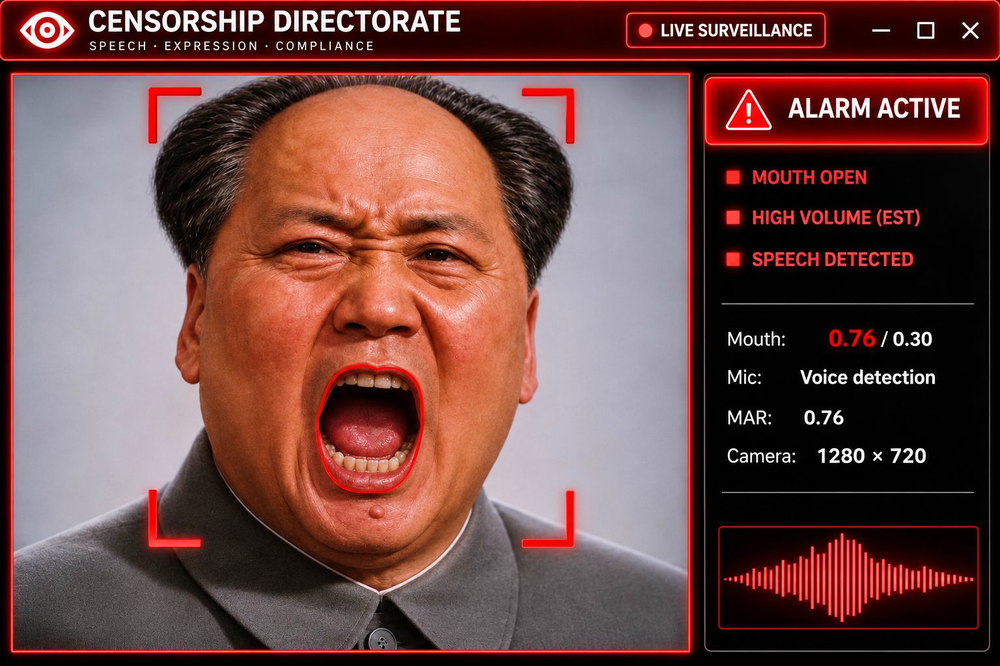

<p align="center">
  
</p>

# Censorship Directorate

A Windows app that gets annoyed when you open your mouth.

I saw [Raul Engineer's video](https://www.youtube.com/shorts/dYAdNCzWI3o) and wanted to make something similar. It watches your webcam and microphone, and sets off an obnoxious 1 kHz test tone whenever you break one of its completely reasonable rules.

Open your mouth? Alarm. Cover your mouth? the state hears 

**[Download the latest version](https://github.com/billyke2000s/censorship-directorate-/releases/latest)**

## What it looks like

<p align="center">
  
</p>

## Getting it running

You need **Windows**, a **webcam**, and **64-bit Python 3.14**. A microphone is optional.

1. Grab the ZIP from [Releases](https://github.com/billyke2000s/censorship-directorate-/releases/latest) and extract it.
2. [Install Python 3.14](https://www.python.org/downloads/windows/) if you haven't already. Make sure the Python launcher (`py`) is installed.
3. Double-click `Start-MouthAlarm.cmd` in the extracted folder.

The first launch installs the Python packages and downloads the face/hand tracking models, so it needs an internet connection. After that, just use the same launcher. Close the window normally to stop it.

**It's a source ZIP, not an EXE.** Python needs to be installed first.

## What makes it go off?

| Alarm | What it detects |
| --- | --- |
| **MOUTH OPEN** | Your mouth opens past the threshold. Yawning counts, unfortunately. |
| **MOUTH COVERED** | Your hand covers your mouth for a moment. |
| **MIC: VOICE DETECTED** | The microphone picks up speech-like sounds. |
| **HEAD TURNED AWAY** | You turn your head away from the camera. |
| **FACE NOT VISIBLE** | Your face disappears from view. |
| **MULTIPLE FACES** | More than one face is detected. |
| **CAMERA COVERED** | The camera image goes very dark or almost featureless. |
| **FACE IMAGE STILL** | Your face barely moves for five seconds. |

The mouth-open alarm triggers at a mouth aspect ratio of **0.30** and clears below **0.22**. Covering your mouth takes about **0.24 seconds** to trigger.

It's not perfect. Bad lighting, background noise and sitting unusually still can set it off although it's quite good 

## Using it as a microphone in calls

There's an optional mode that replaces your voice with the alarm tone in a call this was ais idea not mine haha 

1. Install [VB-CABLE](https://vb-audio.com/Cable/) and restart Windows if it asks.
2. Run `Start-Virtual-Mic.cmd` instead of the normal launcher.
3. In Discord or whichever call app you're using, select **CABLE Output** as your microphone.

The app reads your physical mic and sends processed audio to **CABLE Input**. When there's no alarm, your mic audio passes through. When one goes off, it sends the tone instead.

There's around **0.9 seconds of buffering**, plus audio-device delay. Don't expect it to be perfectly instant, and some call apps will suppress the tone.

## A few options

Run the launcher from PowerShell if you want to pass arguments:

| Option | What it does |
| --- | --- |
| `--resolution WIDTHxHEIGHT` | Request a camera resolution, e.g. `1920x1080`. By default it tries modes up to 4K. |
| `--mic INDEX` | Pick a particular microphone. |
| `--no-mic` | Run without the microphone. |
| `--check-models` | Check whether the tracking models load. |

Example:

```powershell
.\Start-MouthAlarm.cmd --resolution 1920x1080
```

To see your microphone device indexes after setup:

```powershell
.\.venv\Scripts\python.exe -m sounddevice
```

## Privacy

The camera and microphone are processed locally. The app doesn't save or upload your video or audio. It does download dependencies and tracking models during setup.

It doesn't transcribe speech or work out what you're saying. It just decides whether something looks or sounds like one of its alarms.

## Running it manually

If you don't want to use the launcher, open PowerShell in the project folder:

```powershell
py -3.14 -m venv .venv
.\.venv\Scripts\python.exe -m pip install -r requirements.txt
powershell -NoProfile -File .\setup-models.ps1
.\Start-MouthAlarm.cmd
```

To run the tests:

```powershell
.\.venv\Scripts\python.exe -m unittest -v
```
