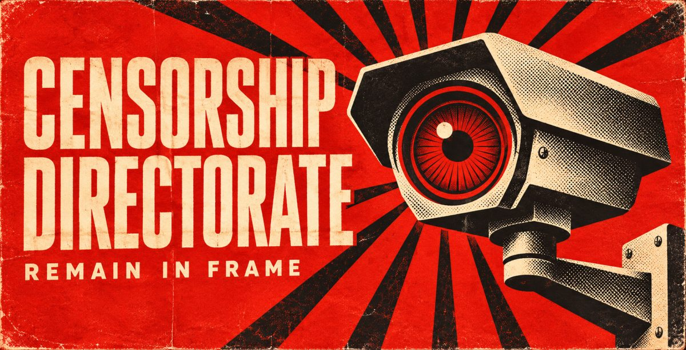
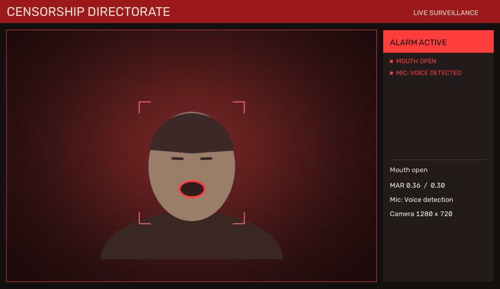

<p align="center">
  
</p>

<p align="center"><strong>PUBLIC ADDRESS CONTROL DIVISION</strong><br>
WINDOWS SURVEILLANCE CONSOLE · OPERATOR MANUAL</p>

<p align="center">
  <a href="#order-01--activate-the-station">ACTIVATION</a> ·
  <a href="#order-02--read-the-alarm-panel">ALARM REGISTER</a> ·
  <a href="#order-04--route-call-audio">CALL AUDIO</a>
</p>


*Fictional surveillance software inspired by Raul Engineer’s demo.* [Original short](https://www.youtube.com/shorts/dYAdNCzWI3o)

## ORDER 01 · ACTIVATE THE STATION

1. Install [64-bit Python 3.14](https://www.python.org/downloads/windows/).
2. Extract the entire project ZIP. Keep the launcher with the other project files.
3. Double-click **`Start-MouthAlarm.cmd`**. On first launch, it installs the dependencies and downloads the camera models.

Use the same launcher for each session. Close the station with the window’s **X** button.

## ORDER 02 · READ THE ALARM PANEL

The station sounds a continuous **1 kHz television test tone** while an alarm is active. The right-hand panel lists every active alarm.

<p align="center">
  <br>
  <em>Console demonstration with an illustrated camera feed.</em>
</p>

| Alarm | Trigger |
| --- | --- |
| **MOUTH OPEN** | The inner-lip aspect ratio reaches 0.30. The alarm clears below 0.22. The on-screen outline follows the outer lips. |
| **MOUTH COVERED** | A tracked hand overlaps the center or most of the mouth for about 0.35 seconds. The station retains the last clear lip position during the obstruction. |
| **MIC: VOICE DETECTED** | The microphone detects speech activity, including individual letter sounds. No dictionary is used. |
| **HEAD TURNED AWAY** | Head-turn evidence persists for about 0.65 seconds. A side-profile detector and a short grace period cover brief tracking gaps. |
| **FACE NOT VISIBLE** | The station loses sight of the face for about one second. |
| **MULTIPLE FACES** | The station detects more than one face for about one second. |
| **CAMERA COVERED** | No face is visible and the image stays very dark or nearly featureless for about 0.6 seconds. |
| **FACE IMAGE STILL** | A tracked face stays nearly still for five seconds. The warning clears when movement resumes. |

**Operator advisory.** A dark room or plain wall can trigger **CAMERA COVERED**. Sitting very still can trigger **FACE IMAGE STILL**. Short, quiet speech and background noise can affect voice detection. These alarms report detection results and do not establish intent or reliably identify every prop, overlay, or replayed feed.

## ORDER 03 · CONFIGURE THE STATION

The console opens the default camera, tries camera modes up to 4K, and displays the resolution it receives. Face and hand tracking use a smaller copy capped at 960 pixels on the longest edge. The preview uses the newest full-resolution frame and preserves its proportions when the window is resized.

| Launcher option | Purpose |
| --- | --- |
| `--resolution WIDTHxHEIGHT` | Request a camera mode, such as `1920x1080`. |
| `--mic INDEX` | Select a microphone by its device index. |
| `--no-mic` | Run with the camera only. |
| `--check-models` | Load the face and hand models without opening the camera. |

Pass options from PowerShell, for example `.\Start-MouthAlarm.cmd --resolution 1920x1080`. To list microphone indexes after setup, run `.\.venv\Scripts\python.exe -m sounddevice`.

## ORDER 04 · ROUTE CALL AUDIO

1. Install [VB-CABLE from VB-Audio](https://vb-audio.com/Cable/) and restart Windows as directed by its installer.
2. Open **`Start-Virtual-Mic.cmd`**. The station sends processed audio from your default Windows microphone to **CABLE Input**. Pass `--mic INDEX` to select another physical microphone.
3. In the call app, select **CABLE Output** as the microphone. Keep your headphones or speakers as the playback device and leave the station running.

The call receives microphone audio during clear periods and the tone during detected alarms. Routing adds about **0.9 seconds** of buffering plus device latency. Missed detections can let speech through, and some call apps suppress sustained tones.


## TECHNICAL ANNEX · MANUAL SETUP

Run from the extracted source folder in PowerShell:

```powershell
py -3.14 -m venv .venv
.\.venv\Scripts\python.exe -m pip install -r requirements.txt
powershell -NoProfile -File .\setup-models.ps1
.\Start-MouthAlarm.cmd
```

The station processes video and audio locally. It does not save or upload footage or audio.

Run the test suite:

```powershell
.\.venv\Scripts\python.exe -m unittest -v
```
