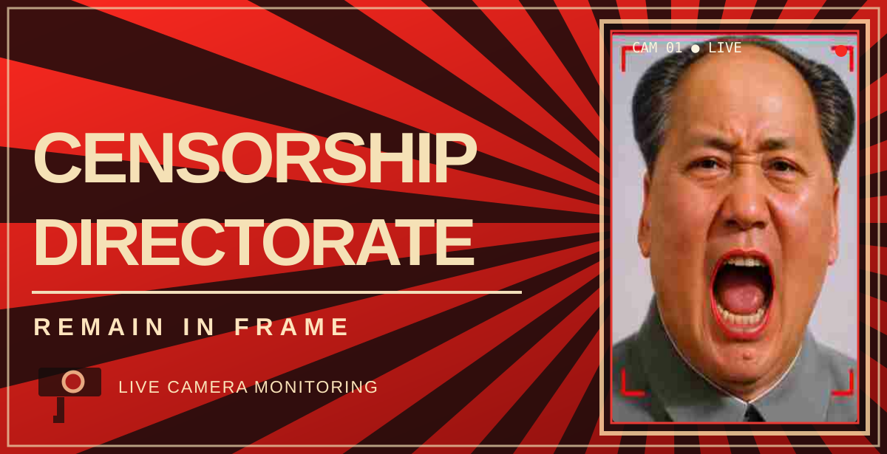

<p align="center">
  
</p>

<h1 align="center">Censorship Directorate</h1>
<p align="center"><strong>The world's most dramatic way to be told to shut up.</strong></p>

<p align="center">
  <a href="https://github.com/billyke2000s/censorship-directorate-/releases/latest"><strong>Download the latest release</strong></a>
  ·
  <a href="#getting-started">Get started</a>
  ·
  <a href="#what-sets-it-off">What sets it off?</a>
  ·
  <a href="#make-it-annoy-your-friends-too">Call audio</a>
</p>

Ever wanted a webcam that judges you for opening your mouth?

No? Well, that's unfortunate.

**Censorship Directorate** is a deliberately ridiculous Windows webcam and microphone experiment. It watches for things like speaking, opening or covering your mouth, looking away, or disappearing from the camera, then responds with a red warning screen and a thoroughly unpleasant **1 kHz test tone**.

Basically, imagine a dystopian government getting upset because you yawned.

It's a **joke project**, not an actual security system, and it's inspired by [Raul Engineer's original demo](https://www.youtube.com/shorts/dYAdNCzWI3o).

## Behold, the Department of Keeping Your Mouth Shut

<p align="center">
  
</p>

<p align="center"><em>Illustrative screenshot. Your actual face will be supplied by your webcam, whether the Directorate approves or not.</em></p>

The app has a live camera preview, face-tracking corners, a mouth outline, a red alarm panel and a microphone activity display. The interface resizes with the window; the tracking and alarm checks run on your own PC.

## Getting started

**You'll need:** Windows, a webcam, and **64-bit Python 3.14**. A microphone is recommended unless you prefer to be judged in silence.

1. [Download the latest release](https://github.com/billyke2000s/censorship-directorate-/releases/latest) and extract the **Windows source ZIP**.
2. Install [Python 3.14 (64-bit)](https://www.python.org/downloads/windows/). Make sure the `py` launcher is available.
3. Open the extracted folder and double-click **`Start-MouthAlarm.cmd`**.
4. Allow camera and microphone access if Windows asks.

The launcher sets up the Python environment, installs dependencies and downloads the tracking models on first run. Subsequent launches use the same `.cmd` file. Close the app with the window's **X**.

**Important:** The download is a **source ZIP, not a standalone EXE**. You still need Python installed.

## What sets it off?

| Alarm | Your crime against the Directorate |
| --- | --- |
| **MOUTH OPEN** | You opened your mouth. Could be a yawn. Could be treason. The software doesn't know. |
| **MIC: VOICE DETECTED** | You made a speech-like noise. Even a short one can count. |
| **MOUTH COVERED** | Your hand is covering your mouth. Apparently that's suspicious too. |
| **HEAD TURNED AWAY** | You looked away from Big Brother. Rude. |
| **FACE NOT VISIBLE** | You've left the camera's field of view without filing the appropriate paperwork. |
| **MULTIPLE FACES** | More than one face appeared. An unauthorised committee meeting. |
| **CAMERA COVERED** | The camera sees something very dark or featureless. It assumes the worst. |
| **FACE IMAGE STILL** | Your face barely moved for five seconds. The Directorate suspects you've turned into a photograph. |

When an alarm is active, the app shows it in the right-hand panel and plays a looping **1 kHz tone** (unless you're routing the alarm through the virtual microphone).

A few things worth knowing before declaring yourself a political prisoner:

- **MOUTH OPEN** activates at a mouth-aspect ratio of about **0.30** and clears below **0.22**. The red outline follows the tracked lips.
- **MOUTH COVERED** requires roughly **0.24 seconds** of overlapping hand/mouth evidence.
- A dark room, plain wall, very still face or noisy room can lead to false alarms. This is not a reliable way to determine what anyone is actually doing.
- The example artwork is **just a demonstration**. The app uses your live camera feed, not the portrait in the README.

## Make it annoy your friends too

Want your Discord call to hear the alarm instead of you? That's what the optional virtual-microphone mode is for.

1. Install [VB-CABLE](https://vb-audio.com/Cable/) and restart Windows if requested.
2. Start **`Start-Virtual-Mic.cmd`** in the project folder.
3. In your call app, set the microphone to **CABLE Output**. Your physical mic is fed to the app; processed sound is sent to **CABLE Input**.

Normal audio passes through when things are clear. When an alarm triggers, the app routes the test tone instead.

**Disclaimer from the Ministry of Fun:** This isn't instant or foolproof. Routing adds about **0.9 seconds of buffering**, plus device latency. Missed detections can let speech through, and some call apps will try to suppress the tone.

## Settings and useful commands

You can pass these options to the normal launcher from PowerShell:

| Option | What it does |
| --- | --- |
| `--resolution 1920x1080` | Requests a particular camera resolution (up to 4K is tried by default). |
| `--mic INDEX` | Chooses a particular microphone. |
| `--no-mic` | Camera-only mode. The state cannot hear you now. |
| `--check-models` | Checks that the downloaded face and hand models load. |

For example:

```powershell
.\Start-MouthAlarm.cmd --resolution 1920x1080
```

To list microphone device indexes after the environment has been created:

```powershell
.\.venv\Scripts\python.exe -m sounddevice
```

## Privacy (yes, seriously)

Camera frames and microphone audio are processed **locally on your computer**. The app does **not** record or upload your footage or audio. The initial setup does download Python dependencies and camera models.

It detects basic face, mouth, hand and speech activity. It does **not** know what you're saying, establish intent, or identify who you are. And please don't use a joke surveillance app to secretly monitor people.

## For people who enjoy opening terminals

If you'd rather set things up manually, run this in PowerShell from the extracted project folder:

```powershell
py -3.14 -m venv .venv
.\.venv\Scripts\python.exe -m pip install -r requirements.txt
powershell -NoProfile -File .\setup-models.ps1
.\Start-MouthAlarm.cmd
```

Run the tests:

```powershell
.\.venv\Scripts\python.exe -m unittest -v
```


<p align="center"><strong>REMAIN IN FRAME. REMAIN SILENT. REMAIN EXTREMELY NORMAL.</strong><br><em>The Directorate thanks you for your involuntary cooperation.</em></p>
